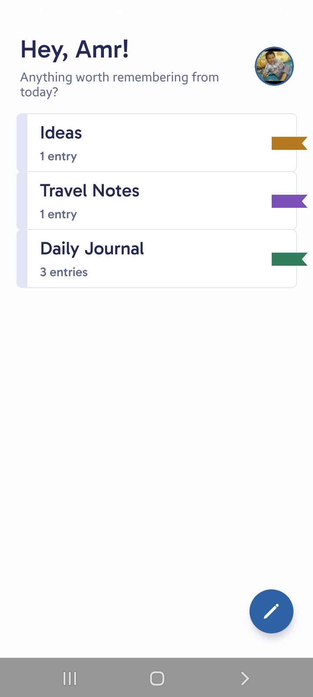
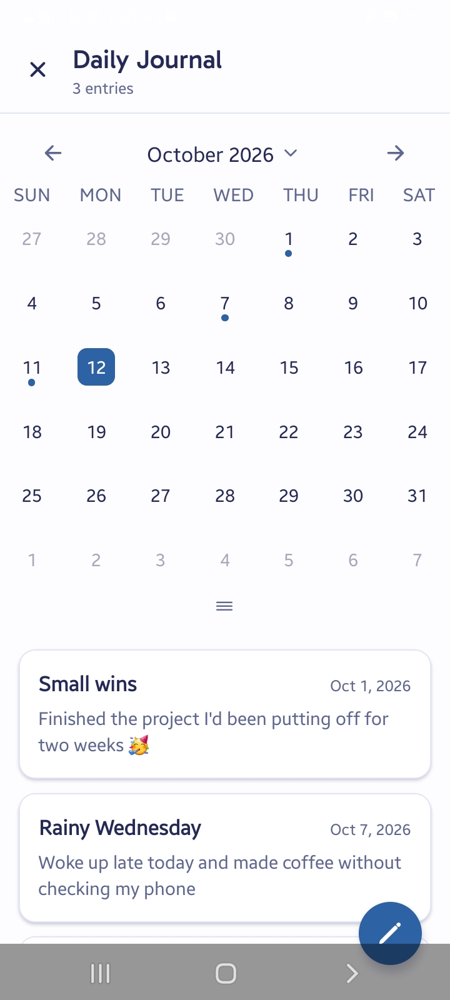
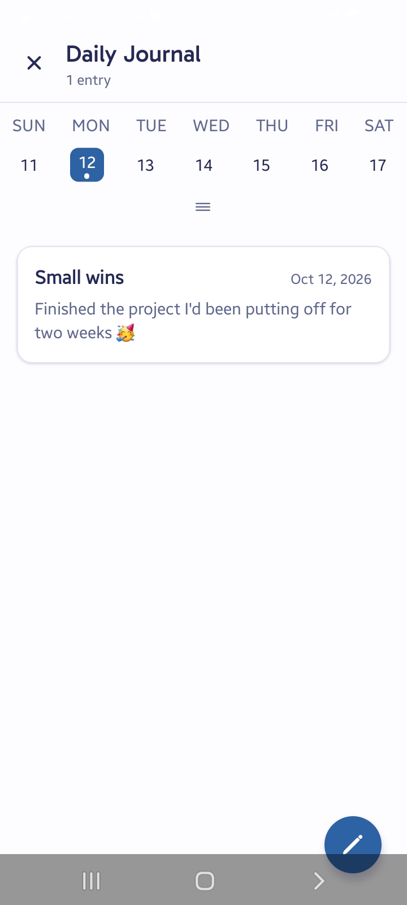
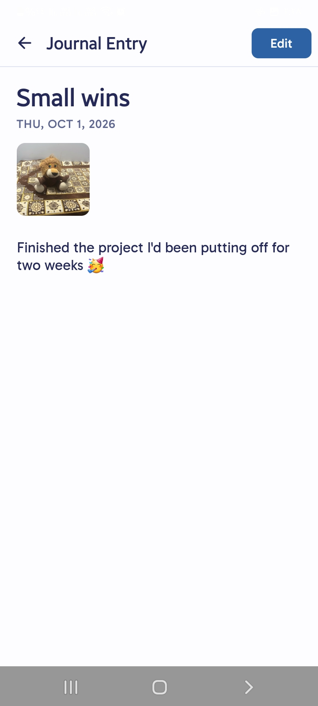
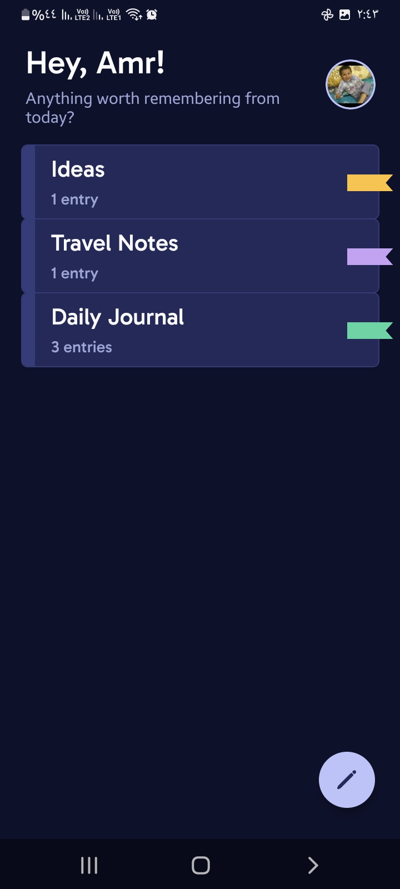
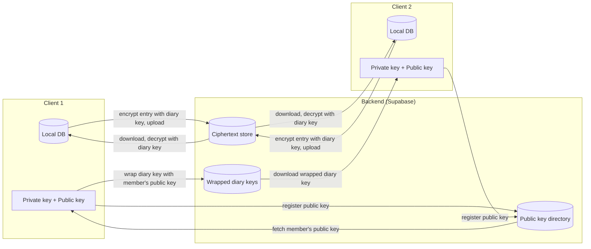

# Quill

## Overview

An offline-first, privacy-focused social journaling app. Create a diary, invite friends, and journal together.

## Screenshots

| Diaries | Calendar | Entry List | Entry | Dark Mode |
| :---: | :---: | :---: | :---: | :---: |
|  |  |  |  |  |

## Features

- **Multiple diaries**: Organize your thoughts with separate diaries which are encrypted and saved into your local database
- **Calendar**: Jump to any date and quickly add an entry with a tap
- **Rich Entries**: Bring your journals to life with beautiful text formatting, photos, videos and voice recordings
- **Accounts**: Sign up and add your own profile picture
- **Polished experience**: Haptic feedback, dark mode, and a clean design you will enjoy writing in

## Upcoming Features

These features are planned but not yet implemented.

- **Shared Diaries**: Get invited by friends or invite them, and have a safe space to write and view each other's thoughts.
- **Different Views**: See your entries in many views: list, gallery, timeline and more.
- **More customization options**: Change the diary's color and more. We love customization and you do too.
- **Locked Diaries**: Save your secrets with locked diaries. Spies are everywhere.
- **Notifications**: Get a notification every day to remember to keep the streak.
- **Encrypted sync**: Your shared diaries' entries will be saved in an external database using end-to-end encryption, so only you and your friends can read them.

The diagram below shows the planned design for encrypted syncing once this feature is implemented:

## Tech Stack

- **React Native + Expo**
- **Expo Router** — used for navigation between screens
- **TypeScript**
- **Local database**: SQLite via `expo-sqlite`
- **Rich text editor**: `10tap-editor` — used for implementing the editor
- **React Native Reanimated and Gesture Handler**: Used to make smooth animation and gesture-based interactions

---

**Curious to learn more?** See [ARCHITECTURE.md](./ARCHITECTURE.md) for the app's architecture, data models, and more.
